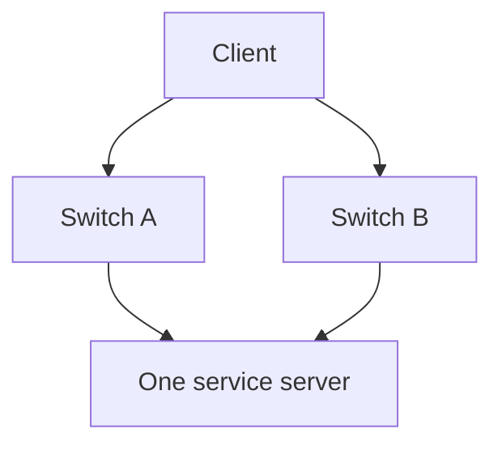

# Exercise 19: find the shared point of failure

[Game study ideas](../../resources/steam-data-center-games.md) · [Recovery guide](../../study-guides/backup-and-recovery.md) · [Contents](../../study/contents.md)

Offline fictional exercise. No software or purchase required. Partial SY0-701 3.4. Status: ready to try.

## Inspect the design

The client can reach either switch. Both switches connect to one server. Assume all shown links work, the client can use either path, and the server is the only instance of the required service. Ignore routing configuration and power for the first question.

1. If Switch A fails, is a drawn path to the service still available?
2. If the server fails, does the alternate switch help?
3. Now suppose both switches share one power source. What failure could remove both network paths?
4. The team takes a nightly backup. Does that alone keep the service running during a server failure?

Write the failed component, affected dependency, and remaining capability for each.

Worked answers

1. Yes, the drawn path through Switch B remains under the stated assumptions.
2. No. Both paths end at the same failed server. Two network paths do not create a second service instance.
3. Loss of their shared power source could remove both paths. The drawing alone did not show that dependency.
4. No. A backup can support recovery but does not itself provide a running replacement. You still need a restoration process, usable resources, and verified recovery timing.

## Change the design

Propose one change for network failure and a separate change for service failure. Identify any shared dependency your proposal still has. Do not assume that adding a second server automatically configures failover or keeps data consistent.

If you own a simulator or game with relevant controls, test one supported change there. Record behavior as observed in that product, then explain which real-world assumptions it leaves untested.

## Explain the exam connection

The useful distinction is between an alternate path, an available service, and recoverable data. Read the [recovery guide](../../study-guides/backup-and-recovery.md) and explain which requirement each addresses.

Keep your answers and proposed change as a [learning note](../../study/hands-on-notes.md). This is an original study task, not an official exam question.
