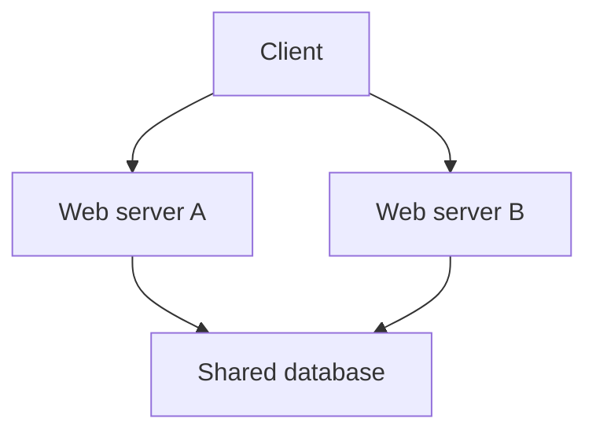

# Exercise 24: trace the service dependency

[Contents](../../study/contents.md) · [Recovery guide](../../study-guides/backup-and-recovery.md)

Offline fictional exercise. Partial SY0-701 3.4. Ready to try.

## The design

Two web servers share one database. The client can reach either web server. For this task, both web servers need the database for every successful request. Assume network paths work.

Predict the result of each change:
- Web server A stops.
- The database stops.
- A second web server is added, but it still uses the same database.
- A backup of the database is available, but no replacement is running.

For each, say whether a working request path remains under the stated assumptions.

Worked answer

Web server B can still serve requests after A fails. A database failure prevents either web server from completing the required request. Another web server does not remove that database dependency.

A backup supports recovery, but is not a running database. You still need a restoration process and validation. Identify the required recovery time and data point before deciding whether the arrangement meets the business need.

## Apply the idea visually

In a game or simulator you already own, draw a small dependency map from supported behavior. Label anything the product does not model. Trace one failure through the drawing before changing a supported component.

No game purchase is required. This diagram does not establish real failover, replication, or routing behavior.

[Review questions](../../practice-tests/data-center-decisions-17.md) · [Cards](../../anki/data-center-decisions.txt) · [Learning notes](../../study/hands-on-notes.md)

Supporting reading: [NIST SP 800-34 Rev. 1](https://csrc.nist.gov/pubs/sp/800/34/r1/upd1/final). The diagram and conditions are original.
