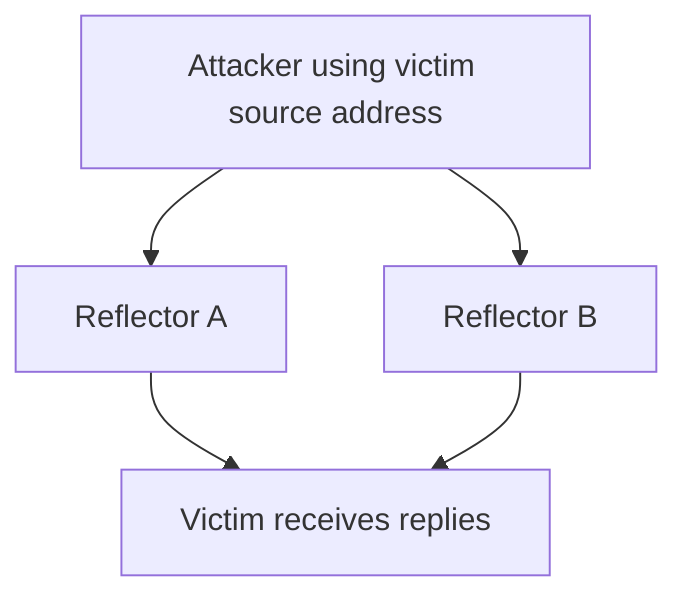

# Exercise 28: follow the reflected replies

[Read first](../../study-guides/denial-of-service.md) · [Dataset](flows.csv) · [Contents](../../study/contents.md)

Offline fictional exercise. Partial SY0-701 2.4. Ready to try. No traffic-generation commands are needed.

## Stated evidence

The sample records three reflectors. The exercise stipulates that spoofing has been confirmed: requests claim the victim's source address. Each row measures one request and the resulting response using the same byte-count convention. Separate service monitoring confirms that combined traffic in the wider incident disrupts the victim's availability.

The drawing shows two of the sample's three reflectors to keep the path clear.

## Your task

For one row, calculate response bytes divided by request bytes. Total all three requests and responses. Identify the evidence for reflection, amplification, and distributed traffic. Explain whether these three sample rows alone establish the incident's full volume.

Worked answer

Each row has a ratio of 600 / 60 = 10. Totals are 180 request bytes and 1,800 response bytes, also a ratio of 10 under the stated convention.

The confirmed spoofed address explains why replies go to the victim: reflection. The larger measured replies establish amplification. Several reflectors supply distributed response sources in the stated incident.

The rows are a small sample, not the full incident count or rate. Availability disruption is separately stipulated; do not infer it merely from 1,800 bytes.

Change the response size to 60 bytes. The ratio becomes one: the stated reflection still occurs, but these measurements no longer show amplification.

[Questions](../../practice-tests/availability-and-access-18.md) · [Learning notes](../../study/hands-on-notes.md). Supporting definitions are linked in the guide.
